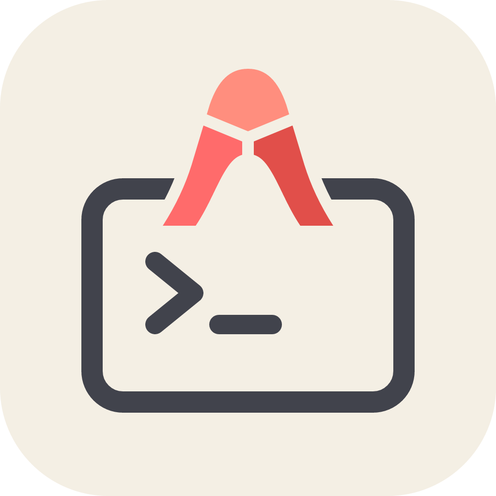

# Antigravity Delegate

Delegate edits to Google Antigravity's CLI agent (`agy`) — your agent writes the brief and reviews the diff.

[](LICENSE)



Antigravity Delegate is the MCP bridge that lets Claude Code, ChatGPT/Codex, Copilot — or any MCP client — hand implementation to **agy** over the Agent Client Protocol, then get a structured result back for review.

<br clear="left">


## Features

- 🤝 **Native plugins** — install into Claude Code, ChatGPT/Codex, or GitHub Copilot CLI and say *"delegate this to Antigravity"*. The shared skill teaches your agent how to delegate well.
- 💬 **No stalled runs** — if agy needs to clarify, it ends the turn and returns the question as a normal result. Your agent answers by resuming the same session.
- 📦 **Named results** — final answer, changed files, session id, model and thinking level, returned as one compact JSON payload.
- 📋 **Plan first** — `plan` mode: agy writes a plan, returned in full as `plan`; you review it, then the same session implements it.
- 🔍 **Ask anything** — `ask` mode: Q&A over your codebase.
- 🩺 **Self-diagnosing** — a `doctor` tool that reports what is missing, the models agy offers, and the account tier.

`plan` and `ask` are instructions to the agent, and `workspace` is its working directory — [Security](SECURITY.md) and the [delegate reference](skills/delegate/reference.md) spell out what the bridge enforces and what it reports back.

## Install

You need [Node.js 20+](https://nodejs.org/) and the Antigravity CLI (`agy`), signed in — run `agy` once and sign in.

### Claude Code

```shell
/plugin marketplace add andreilungeanu/agy-delegate-mcp
/plugin install agy-delegate@agy-delegate-mcp
```

Then ask:

> Delegate to Antigravity: migrate src/api from callbacks to async/await and update the tests, then walk me through what changed.

### ChatGPT desktop / Codex

```shell
codex plugin marketplace add andreilungeanu/agy-delegate-mcp
codex plugin add agy-delegate@agy-delegate-mcp
```

### GitHub Copilot CLI

```shell
copilot plugin marketplace add andreilungeanu/agy-delegate-mcp
copilot plugin install agy-delegate@agy-delegate-mcp
```

### Any other MCP client

```json
{
  "mcpServers": {
    "agy-delegate": {
      "command": "npx",
      "args": ["-y", "agy-delegate-mcp"]
    }
  }
}
```

VS Code uses `servers` with `"type": "stdio"` in `.vscode/mcp.json`; OpenCode and Kilo Code use `mcp` with `"type": "local"` and `command` as one array.

## License

MIT © [Andrei Lungeanu](https://github.com/andreilungeanu)

<sub>[Technical reference](TECHNICAL.md) · [Security](SECURITY.md) · [Privacy](PRIVACY.md) · [Terms](TERMS.md)</sub>
