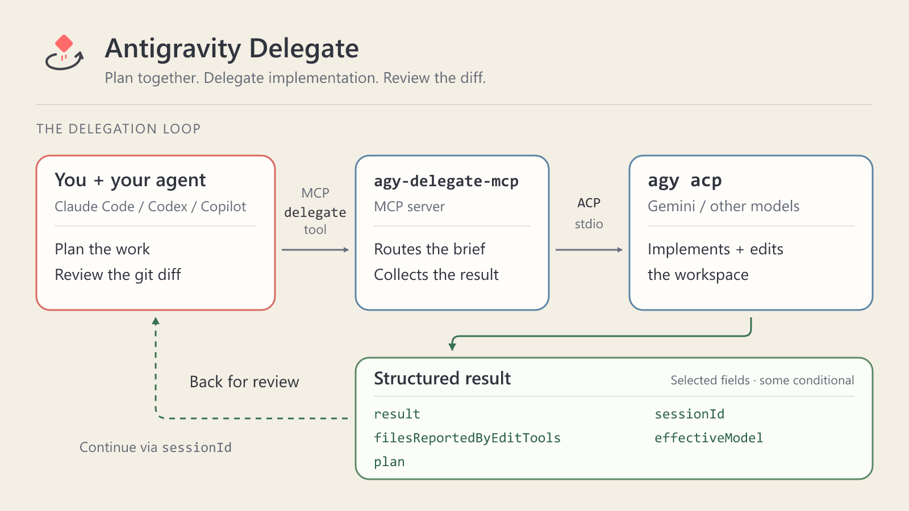
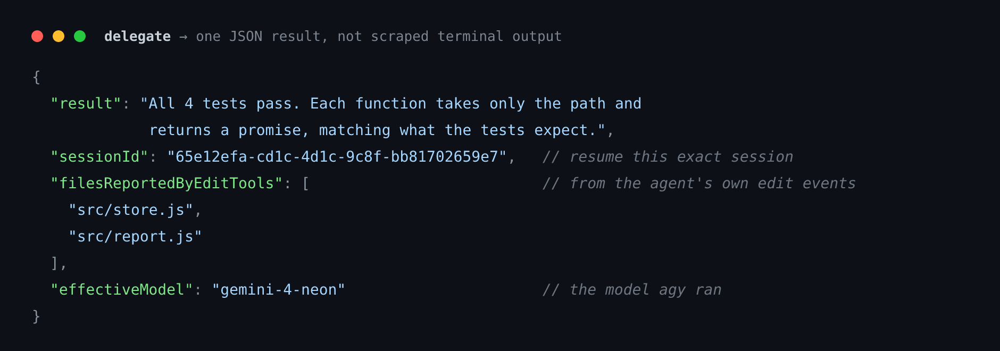

# Antigravity Delegate

**Ask Gemini what it thinks. Or hand it the work.**

[](https://www.npmjs.com/package/agy-delegate-mcp)
[](https://www.npmjs.com/package/agy-delegate-mcp)
[](https://registry.modelcontextprotocol.io/v0.1/servers?search=agy-delegate&version=latest)
[](https://glama.ai/mcp/servers/andreilungeanu/agy-delegate-mcp)
[](https://nodejs.org)
[](LICENSE)
[](https://github.com/andreilungeanu/agy-delegate-mcp/actions/workflows/test.yml)


Antigravity Delegate is the MCP bridge to **Google Antigravity's CLI agent (`agy`)**. From Claude Code, ChatGPT/Codex, Cursor, Copilot or any MCP client, your agent can ask Gemini for a second opinion, put one question to several models at once, or hand agy a task to plan or build, and get a structured result back from each call.

<br clear="left">

## 🧠 Get a second opinion

> Ask Gemini Neon high what it thinks about moving the session store to SQLite.

agy reads the repo and answers in `ask` mode, and your agent sets that answer beside its own. You see where the two disagree before you choose a direction.

Ask several at once, and your agent sends each the same brief in parallel, compares the answers, and checks the claims that matter:

> Ask Gemini Neon and Gemini Flash whether we should split this service, and tell me where they disagree.

With [Codex Delegate](https://github.com/andreilungeanu/codex-delegate-mcp) or [Cursor Delegate](https://github.com/andreilungeanu/cursor-delegate-mcp) installed too, the same prompt reaches GPT, Composer or Grok.

## 🛠️ Hand off the work

> Delegate to Antigravity: migrate src/api from callbacks to async/await and update the tests. Plan it first.

Your agent writes the brief, agy edits the files, and your agent reads the diff and runs the tests before it reports back.

- 📋 **Plan, approve, build** — `plan` mode returns agy's plan artifact in full as `plan`; once you approve, the same session implements it.
- 💬 **Questions with options** — when agy needs a decision, the turn ends with its questions, their options and the one it recommends. Your agent answers by resuming the same session.
- 🧭 **Steer mid-turn** — `steer` redirects a delegation that is still running, without starting over. It needs a host that can call tools while `delegate` runs, such as Claude Code with background tasks.



## Features

- 📦 **Named results** — final answer, the files agy's edit tools reported changing, session id, model and thinking level, the commands agy ran with their exit codes, and token usage, returned as one compact JSON payload.
- ⏳ **Runs in the background in Claude Code** — in the main session of the interactive Claude Code CLI, `delegate` runs as an MCP task: the call returns once agy has the prompt, and the result arrives as a task notification when agy finishes. Calls from subagents wait for the result.
- 🖼️ **Attach what prose can't point at** — `contextFiles` sends screenshots, mockups and other files along with the brief.
- 🔋 **Runs on your Antigravity plan** — delegated work uses the Google account agy is signed into, separate from your host's chat quota.
- 🤝 **Native plugins** — install into Claude Code, ChatGPT/Codex, or GitHub Copilot CLI and say *"ask Gemini"* or *"delegate this to Antigravity"*. The shared skill teaches your agent to write the brief and review the result.
- 🩺 **Self-diagnosing** — a `doctor` tool that reports what is missing and, with `deep: true`, the models agy offers and your account tier.

`plan` and `ask` are instructions to the agent, and `workspace` is its working directory — [Security](SECURITY.md) and the [delegate reference](skills/delegate/reference.md) spell out what the bridge enforces and what it reports back.



## The Delegate family

Each plugin works on its own. Install the ones your subscriptions cover, and your agent can ask them the same question in one turn.

| Plugin | Brings in | Stands out for |
| --- | --- | --- |
| [Codex Delegate](https://github.com/andreilungeanu/codex-delegate-mcp) | OpenAI Codex CLI · GPT models | native code review, schema-validated plans |
| [Cursor Delegate](https://github.com/andreilungeanu/cursor-delegate-mcp) | Cursor CLI · Composer, Grok | plan then build in one session, todo progress, image attachments |
| **Antigravity Delegate** (this one) | Antigravity CLI · Gemini | steering a running turn, structured questions, plan artifacts |

## Install

You need [Node.js 20+](https://nodejs.org/) and the Antigravity CLI (`agy`), signed in — run `agy` once and sign in.

### Claude Code

```shell
/plugin marketplace add andreilungeanu/agy-delegate-mcp
/plugin install agy-delegate@agy-delegate-mcp
```

Then ask:

> Delegate to Antigravity: migrate src/api from callbacks to async/await and update the tests, then walk me through what changed.

### Cursor

[](https://cursor.com/en/install-mcp?name=agy-delegate&config=eyJjb21tYW5kIjoibnB4IiwiYXJncyI6WyIteSIsImFneS1kZWxlZ2F0ZS1tY3AiXX0%3D)

Or add it under **Customize → MCPs** in the sidebar, or in `~/.cursor/mcp.json` (every project) or `.cursor/mcp.json` (this project):

```json
{
  "mcpServers": {
    "agy-delegate": {
      "command": "npx",
      "args": ["-y", "agy-delegate-mcp"]
    }
  }
}
```

### ChatGPT desktop / Codex

```shell
codex plugin marketplace add andreilungeanu/agy-delegate-mcp
codex plugin add agy-delegate@agy-delegate-mcp
```

### GitHub Copilot CLI

```shell
copilot plugin marketplace add andreilungeanu/agy-delegate-mcp
copilot plugin install agy-delegate@agy-delegate-mcp
```

The server alone, without the skill: `copilot mcp add agy-delegate -- npx -y agy-delegate-mcp`.

### More clients

<details>
<summary><strong>VS Code</strong> — one-click install, or <code>.vscode/mcp.json</code></summary>

[](https://vscode.dev/redirect/mcp/install?name=agy-delegate&config=%7B%22type%22%3A%22stdio%22%2C%22command%22%3A%22npx%22%2C%22args%22%3A%5B%22-y%22%2C%22agy-delegate-mcp%22%5D%7D)
[](https://insiders.vscode.dev/redirect/mcp/install?name=agy-delegate&config=%7B%22type%22%3A%22stdio%22%2C%22command%22%3A%22npx%22%2C%22args%22%3A%5B%22-y%22%2C%22agy-delegate-mcp%22%5D%7D&quality=insiders)

```json
{
  "servers": {
    "agy-delegate": {
      "type": "stdio",
      "command": "npx",
      "args": ["-y", "agy-delegate-mcp"]
    }
  }
}
```

</details>

<details>
<summary><strong>JetBrains AI Assistant</strong> — Settings → Tools → AI Assistant → MCP</summary>

Under **Settings → Tools → AI Assistant → Model Context Protocol (MCP)**, click **Add** and paste this JSON:

```json
{
  "mcpServers": {
    "agy-delegate": {
      "command": "npx",
      "args": ["-y", "agy-delegate-mcp"]
    }
  }
}
```

</details>

<details>
<summary><strong>Devin Desktop (formerly Windsurf)</strong> — <code>~/.config/devin/mcp_config.json</code></summary>

This config is for Devin Local, the default agent (Local 3.6+). On Windows the file is `%APPDATA%\devin\mcp_config.json`. Legacy Cascade and older Windsurf builds read `~/.codeium/windsurf/mcp_config.json`.

```json
{
  "mcpServers": {
    "agy-delegate": {
      "command": "npx",
      "args": ["-y", "agy-delegate-mcp"]
    }
  }
}
```

Heads-up: Devin Desktop's Cascade agent caps you at 100 tools across all servers.

</details>

<details>
<summary><strong>Visual Studio 2026 / 2022</strong> — <code>%USERPROFILE%\.mcp.json</code></summary>

```json
{
  "servers": {
    "agy-delegate": {
      "type": "stdio",
      "command": "npx",
      "args": ["-y", "agy-delegate-mcp"]
    }
  }
}
```

Visual Studio 2022 needs 17.14+. Note the top-level key is `servers`, not `mcpServers`. A `.mcp.json` in the solution directory scopes it to that solution.

</details>

<details>
<summary><strong>OpenCode</strong> — <code>~/.config/opencode/opencode.json</code> or project <code>opencode.json</code></summary>

OpenCode does **not** use `mcpServers`. Local servers go under `mcp`, with `type: "local"` and `command` as one array:

```json
{
  "$schema": "https://opencode.ai/config.json",
  "mcp": {
    "agy-delegate": {
      "type": "local",
      "command": ["npx", "-y", "agy-delegate-mcp"],
      "enabled": true
    }
  }
}
```

This is the v1 shape, which OpenCode v2 still reads (v2's native form is `mcp.servers`).

</details>

<details>
<summary><strong>Kilo Code</strong> — <code>kilo.jsonc</code> (<code>mcp</code> key, not <code>mcpServers</code>)</summary>

Same shape as OpenCode: `type: "local"` and `command` as one array.

```json
{
  "mcp": {
    "agy-delegate": {
      "type": "local",
      "command": ["npx", "-y", "agy-delegate-mcp"],
      "enabled": true
    }
  }
}
```

In the VS Code extension: **Settings → MCP → Add Server → Local (stdio)**. On Windows, if `npx` is not found, use command `cmd` with arguments `/c`, `npx`, `-y`, `agy-delegate-mcp`.

</details>

### Kiro and any other MCP client

Add the following server to the client's MCP config — for Kiro, `~/.kiro/settings/mcp.json` (user) or `.kiro/settings/mcp.json` (workspace):

```json
{
  "mcpServers": {
    "agy-delegate": {
      "command": "npx",
      "args": ["-y", "agy-delegate-mcp"]
    }
  }
}
```

## License

MIT © [Andrei Lungeanu](https://github.com/andreilungeanu)

<sub>[Technical reference](TECHNICAL.md) · [Security](SECURITY.md) · [Privacy](PRIVACY.md) · [Terms](TERMS.md) · [Changelog](CHANGELOG.md)</sub>
